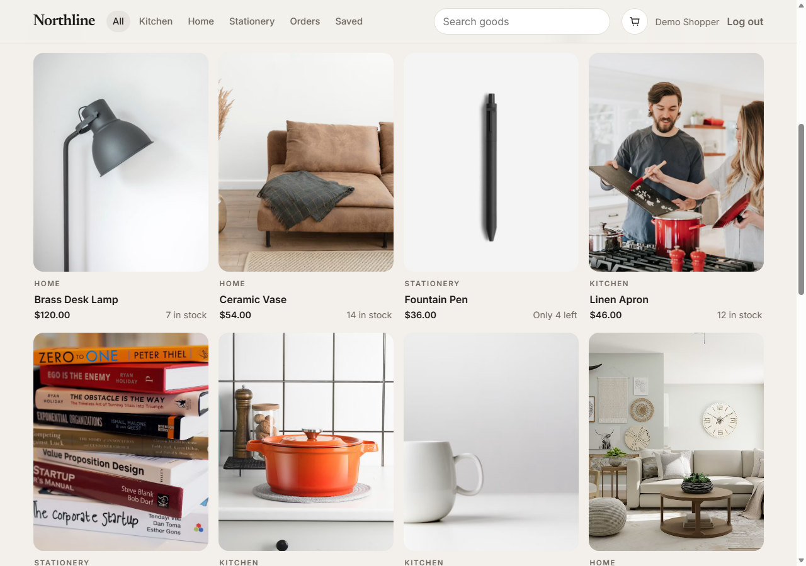
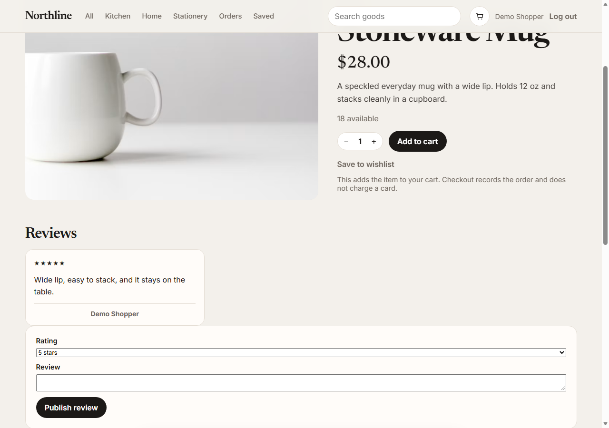

# CodeAlpha Ecommerce Store

Northline is a small-goods shop built for the CodeAlpha full-stack internship. Shoppers can browse products, open a product page, keep a cart, register, log in, and place an order. Orders are stored in MongoDB. No payment is collected.

Buyers who have ordered a product can leave one review. A signed-in shopper can save items to a wishlist, and checkout remembers the shipping address. Stock of five or fewer shows as “Only N left.” An admin can add or hide products and mark an order shipped.

## Screenshots





## Task checklist

| Brief requirement | Where it lives |
| --- | --- |
| Product listings | Home page, `GET /api/products` |
| Product details page | `/products/:id`, `GET /api/products/:id` |
| Shopping cart | `/cart`, `GET/POST/DELETE /api/cart` |
| Order processing | `/checkout` creates an order, reduces stock, clears the cart |
| User registration / login | `/register`, `/login`, JWT on `Authorization: Bearer` |
| Database for products, users, orders | MongoDB database `codealpha_ecommerce` |

## Stack

React (Vite), React Router, Node.js, Express, Mongoose, MongoDB, JWT, bcrypt.

## Setup

Requirements: Node.js 18+ and MongoDB running locally (or a MongoDB Atlas URI).

```bash
npm run install:all
```

Copy the environment file if you are not using the local default, then edit `server/.env`:

```bash
copy .env.example server\.env
```

| Variable | Purpose |
| --- | --- |
| `MONGO_URI` | Mongo connection string. Default database name: `codealpha_ecommerce` |
| `JWT_SECRET` | Secret used to sign login tokens |
| `CLIENT_URL` | Frontend origin allowed by CORS (`http://localhost:5173`) |
| `PORT` | API port (`5001`) |

Seed products and the demo account:

```bash
npm run seed
```

Start the API and the client together:

```bash
npm run dev
```

Open http://localhost:5173

## Demo account

- Email: `demo@codealpha.dev` (shopper)
- Email: `admin@codealpha.dev` (can add, hide, and ship)
- Password: `password123`

You can also register a new account from the Join button.

## API

- `POST /api/auth/register` `{ name, email, password }`
- `POST /api/auth/login` `{ email, password }`
- `GET /api/auth/me`
- `GET /api/products?q=&category=`
- `GET /api/products/:id`
- `GET /api/cart` (auth)
- `POST /api/cart` `{ productId, qty, mode: "add" | "set" }` (auth)
- `DELETE /api/cart/:productId` (auth)
- `POST /api/orders` `{ fullName, line1, city, postalCode }` (auth, also saves the address)
- `GET /api/orders` (auth, current user only)
- `GET /api/orders/all` and `PATCH /api/orders/:id/status` `{ status: "shipped" }` (admin)
- `GET /api/reviews/product/:id`
- `POST /api/reviews/product/:id` `{ rating, text }` (auth, only after ordering that product)
- `GET /api/wishlist` and `POST /api/wishlist/:productId` (auth, toggles a save)
- `GET/POST /api/admin/products` and `PATCH /api/admin/products/:id` (admin)

Suggested GitHub repository name: `CodeAlpha_EcommerceStore`.
