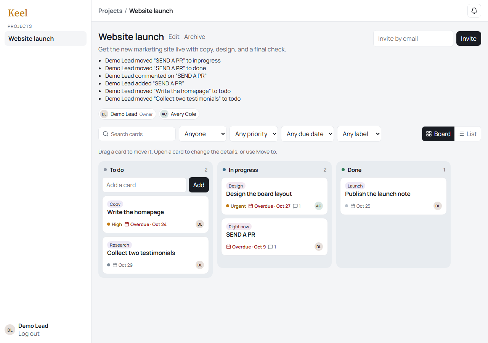

# CodeAlpha Project Management

Keel is a small project board for the CodeAlpha full-stack internship. Members share a project, move task cards across To do, In progress, and Done, assign work, and comment on a card. Socket.io pushes board changes and in-app notifications to the people involved.

The board keeps an activity list for moves, new cards, comments, and archive changes. Each card can hold a checklist. The owner can archive a finished project. Due-date and assignee filters are on the board.

## Screenshots



## Task checklist

| Brief requirement | Where it lives |
| --- | --- |
| Create group projects | Home page, `POST /api/projects` |
| Invite members | Board invite box, `POST /api/projects/:id/members` |
| Assign tasks | Card dialog checkboxes, `PATCH /api/projects/:id/tasks/:taskId` |
| Comment within tasks | Card dialog, `POST /api/projects/:id/tasks/:taskId/comments` |
| Auth | `/login`, `/register`, JWT bearer token |
| Project boards and task cards | `/projects/:id`, drag a card by its handle |
| Users, projects, tasks, comments | MongoDB database `codealpha_projects` |
| Notifications | Bell menu, written when you are invited, assigned, or mentioned by a comment |
| Real-time updates | Socket.io rooms `project:<id>` and `user:<id>` |

## Stack

React (Vite), React Router, dnd-kit, Socket.io client, Node.js, Express, Socket.io, Mongoose, MongoDB, JWT, bcrypt.

## Setup

Requirements: Node.js 18+ and MongoDB (local or Atlas).

```bash
npm run install:all
```

Environment lives in `server/.env`:

```bash
copy .env.example server\.env
```

| Variable | Purpose |
| --- | --- |
| `MONGO_URI` | Mongo connection string. Default database name: `codealpha_projects` |
| `JWT_SECRET` | Secret used to sign login tokens |
| `CLIENT_URL` | Frontend origin allowed by CORS (`http://localhost:5175`) |
| `PORT` | API port (`5003`) |

```bash
npm run seed
npm run dev
```

Open http://localhost:5175

## Demo accounts

Password for both is `password123`.

- `demo@codealpha.dev` owns the seeded “Website launch” board
- `avery@codealpha.dev` is already a member

Open the same board in a second browser (or a private window) as Avery to see a dragged card and a new comment arrive without refreshing. Assigning Avery, inviting someone, or commenting also creates a bell notification.

## API

- `POST /api/auth/register` `{ name, email, password }`
- `POST /api/auth/login` `{ email, password }`
- `GET /api/auth/me`
- `GET /api/projects`
- `POST /api/projects` `{ name, description }`
- `GET /api/projects/:id`
- `PATCH /api/projects/:id` `{ name, description, archived }`
- `POST /api/projects/:id/members` `{ email }`
- `POST /api/projects/:id/tasks` `{ title }`
- `PATCH /api/projects/:id/tasks/:taskId` `{ title, description, assigneeIds, column, position, priority, dueDate, labels, checklist }`
- `GET /api/tasks/mine`
- `DELETE /api/projects/:id/tasks/:taskId`
- `GET /api/projects/:id/tasks/:taskId/comments`
- `POST /api/projects/:id/tasks/:taskId/comments` `{ text }`
- `GET /api/notifications`
- `PATCH /api/notifications/:id/read`
- `POST /api/notifications/read-all`

A card also has `priority` (`none`, `low`, `medium`, `high`, `urgent`), an optional `dueDate`, and up to four `labels`. Project lists include column counts. `GET /api/tasks/mine` returns open cards assigned to you, overdue first. Assignment and comment notifications include the task id so the bell can open that card.

Socket events: client emits `join-project`. Server emits `tasks:sync`, `comment:created`, `activity:created`, and `notification:new`. `GET /api/projects/:id` includes the latest activity. `GET /api/projects?archived=1` lists archived projects.

Suggested GitHub repository name: `CodeAlpha_ProjectManagement`.
