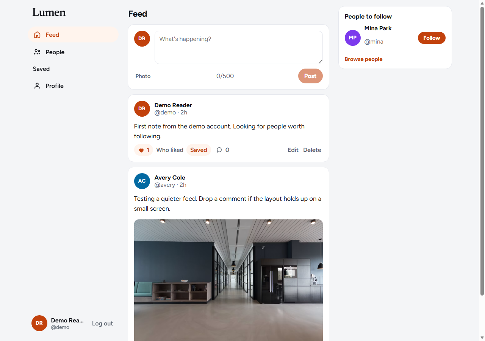

# CodeAlpha Social Media

Lumen is a small social app for the CodeAlpha full-stack internship. Signed-in people can post, edit and delete their own posts, like, comment, follow other accounts, and open a public profile.

A post can include one photo. Likes, comments, replies, and follows show up under Alerts. You can bookmark a post, see who liked it, reply to a comment, and open a profile’s followers and following lists.

## Screenshots



## Task checklist

| Brief requirement | Where it lives |
| --- | --- |
| User profiles | `/u/:username`, `GET /api/users/:username` |
| Edit profile | `/settings`, `PUT /api/users/me` |
| Posts | Feed composer, `POST /api/posts`, edit and delete your own |
| Comments | On each post, `GET/POST /api/posts/:id/comments` |
| Like system | Like button, `POST /api/posts/:id/like` |
| Follow system | People page and profiles, `POST/DELETE /api/users/:id/follow` |
| Database | MongoDB database `codealpha_social` stores users, posts, comments, and follows |

## Stack

React (Vite), React Router, Node.js, Express, Mongoose, MongoDB, JWT, bcrypt.

## Setup

Requirements: Node.js 18+ and MongoDB (local or Atlas).

```bash
npm run install:all
```

Environment lives in `server/.env`. Copy from the example if you need a fresh file:

```bash
copy .env.example server\.env
```

| Variable | Purpose |
| --- | --- |
| `MONGO_URI` | Mongo connection string. Default database name: `codealpha_social` |
| `JWT_SECRET` | Secret used to sign login tokens |
| `CLIENT_URL` | Frontend origin allowed by CORS (`http://localhost:5174`) |
| `PORT` | API port (`5002`) |

```bash
npm run seed
npm run dev
```

Open http://localhost:5174

## Demo accounts

Password for each is `password123`.

- `demo@codealpha.dev` (`demo`) already follows Avery
- `avery@codealpha.dev` (`avery`)
- `mina@codealpha.dev` (`mina`) is not followed yet, so the follow button is easy to show

## API

- `POST /api/auth/register` `{ name, username, email, password }`
- `POST /api/auth/login` `{ email, password }`
- `GET /api/auth/me`
- `GET /api/posts/feed` — your posts plus posts from people you follow
- `POST /api/posts` `{ text }` or a multipart form with `text` and one `image`
- `PUT /api/posts/:id` `{ text }` — author only
- `DELETE /api/posts/:id` — author only
- `POST /api/posts/:id/like` — toggles a like and alerts the author
- `POST /api/posts/:id/bookmark` — toggles a save
- `GET /api/posts/saved`
- `GET /api/posts/:id/likes`
- `GET /api/posts/:id/comments`
- `POST /api/posts/:id/comments` `{ text, parent }`
- `GET /api/users/search?q=`
- `PUT /api/users/me` `{ name, bio }`
- `GET /api/users/:username`
- `GET /api/users/:username/followers` and `GET /api/users/:username/following`
- `POST /api/users/:id/follow`
- `DELETE /api/users/:id/follow`
- `GET /api/notifications` and `POST /api/notifications/read`

Suggested GitHub repository name: `CodeAlpha_SocialMedia`.
