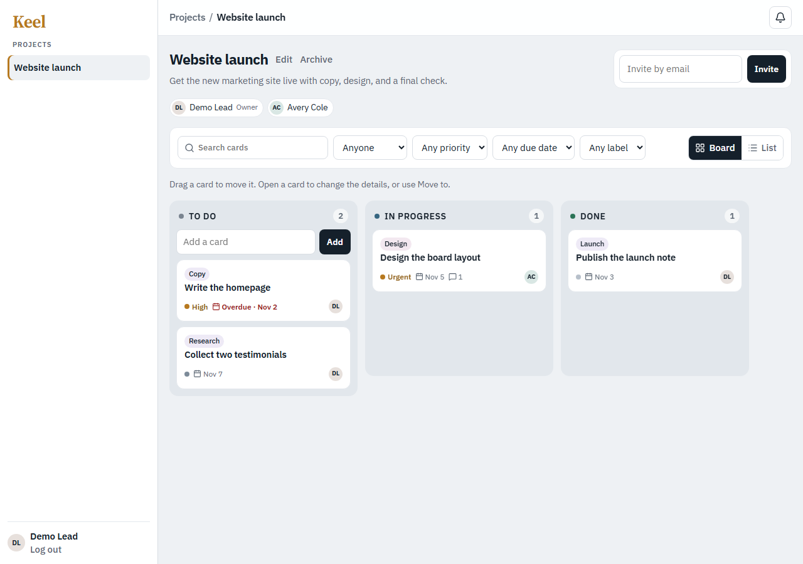

<div align="center">

# 🧩 CodeAlpha Full-Stack Tasks

**Three MERN apps, one repository, and the boring parts done properly.**

[](https://github.com/Salar11111/codealpha_tasks/actions/workflows/ci.yml)


</div>

---

## ✨ Why this repo?

Three internship projects tend to become three abandoned folders. This one keeps them together: a storefront, a social feed and a project board, each with its own client, API, tests, seed data and documentation — plus a single Compose stack that brings them all up with one command.

The interesting parts are the shared conventions. Every API uses JWT auth, bcrypt, Helmet, rate limiting and input sanitising. Every client is a React + Vite app with its own port and proxy. CI checks lint, tests, builds and the Compose image for all three, so a change in one app does not quietly break another.

### 🧩 What's inside

| App | What it does | Local address | API |
| --- | --- | --- | --- |
| [Northline shop](CodeAlpha_EcommerceStore) | Catalog, cart, checkout, reviews, wishlist, admin | http://localhost:5173 | http://localhost:5001 |
| [Lumen feed](CodeAlpha_SocialMedia) | Posts, comments, likes, follows, alerts | http://localhost:5174 | http://localhost:5002 |
| [Keel boards](CodeAlpha_ProjectManagement) | Projects, drag-and-drop tasks, comments, live updates | http://localhost:5175 | http://localhost:5003 |

- 🛒 **Northline shop** — checkout uses a MongoDB transaction, so the Compose database runs as a replica set.
- 💬 **Lumen feed** — React Query on the client and Socket.io for alerts.
- 📋 **Keel boards** — dnd-kit for dragging and Socket.io rooms for live updates.
- 🧪 **Tests everywhere** — Jest API suites for all three servers, lint for all six packages, production builds for all three clients.
- 🐳 **One-command startup** — MongoDB replica set, three APIs and three nginx-served clients.

Each app has its own README with the task checklist, API reference and environment variables.

---

## 📸 Screenshots

| Northline shop | Lumen feed | Keel boards |
| --- | --- | --- |
|  |  |  |


---

## 🚀 Quick start

Requirements: Docker Desktop with Compose.

```bash
docker compose up --build -d
docker compose exec ecommerce-api npm run seed
docker compose exec social-api npm run seed
docker compose exec projects-api npm run seed
```

Then open http://localhost:5173, http://localhost:5174 and http://localhost:5175.

The stack starts a single-node MongoDB replica set (`rs0`), one API per app, and nginx containers that serve each client build and proxy `/api` to its API. Stop it with `docker compose down` (add `-v` to drop the database volume).

### Manual setup

Requirements: Node.js 20+ (the root lint tooling needs 20.19+) and MongoDB. The shop needs MongoDB running as a replica set:

```bash
# Either use the Compose database on its own
docker compose up -d mongo

# Or start mongod yourself, then run rs.initiate() once in mongosh
mongod --replSet rs0 --dbpath ./data/db
```

Install the root lint tooling and every app's dependencies:

```bash
npm run install:all
```

Create an environment file for each API if you are not using the local defaults:

```bash
copy CodeAlpha_EcommerceStore\.env.example CodeAlpha_EcommerceStore\server\.env
copy CodeAlpha_SocialMedia\.env.example CodeAlpha_SocialMedia\server\.env
copy CodeAlpha_ProjectManagement\.env.example CodeAlpha_ProjectManagement\server\.env
```

Seed the demo data, then start any app from its folder:

```bash
cd CodeAlpha_EcommerceStore
npm run seed
npm run dev
```

`npm run dev` starts the API and the Vite client together. See each app's README for its port, database name and full API list.

### Demo accounts

Every seeded account uses the password `password123`.

| App | Accounts |
| --- | --- |
| Northline shop | `demo@codealpha.dev` (shopper), `admin@codealpha.dev` (add, hide, ship) |
| Lumen feed | `demo@codealpha.dev`, `avery@codealpha.dev`, `mina@codealpha.dev` |
| Keel boards | `demo@codealpha.dev` (board owner), `avery@codealpha.dev` (member) |

---

## 🧱 Architecture

```text
Browser (React + Vite)
  ├─ /api/*  ──> Express API ──> MongoDB (replica set)
  └─ socket.io ──> Socket.io server (social alerts, live boards)
```

| Layer | Choice |
| --- | --- |
| Clients | React 18, Vite, React Query, dnd-kit, Socket.io client |
| Servers | Express, Mongoose, JWT, bcrypt, Helmet, rate limiting |
| Database | MongoDB (single-node replica set) |
| Tests | Jest (APIs), ESLint, production client builds |
| Tooling | Docker Compose, nginx, GitHub Actions |

---

## 🗂 Repository layout

```text
CodeAlpha_EcommerceStore/    Northline shop (client, server, docs)
CodeAlpha_SocialMedia/       Lumen feed (client, server, docs)
CodeAlpha_ProjectManagement/ Keel boards (client, server, docs)
.github/workflows/ci.yml     Lint, test and build pipeline
docker-compose.yml           MongoDB replica set, APIs and web clients
eslint.config.js             Shared client lint rules
DEPLOYMENT.md                Production deployment guide
LICENSE                      MIT license
```

---

## ✅ Tests & quality

From the repository root:

```bash
npm run lint         # ESLint for three servers and three clients
npm run test         # Jest API suites for all three servers
npm run build        # Production builds for all three clients
```

The API tests need MongoDB at `MONGO_URI`. To run them against a local replica set:

```powershell
$env:MONGO_URI='mongodb://127.0.0.1:27017/codealpha_ecommerce_test?replicaSet=rs0'
$env:NODE_ENV='test'
$env:JWT_SECRET='local-test-secret-at-least-32-characters'
npm --prefix CodeAlpha_EcommerceStore/server test
```

Use the same pattern with `codealpha_social_test` and `codealpha_projects_test` for the other two suites. CI runs this automatically with a single-node MongoDB replica set in Docker.

---

## 🚢 Deployment

See [DEPLOYMENT.md](DEPLOYMENT.md) for the production checklist: Compose on a VPS, HTTPS, MongoDB replica sets, uploads, cross-site cookies and CORS, plus Render/Railway notes. Each app's `CLIENT_URL` accepts a comma-separated list of origins, and `COOKIE_SAMESITE=none` enables HTTPS split-domain sessions.

---

## 🗺 Roadmap ideas

- 🧪 Client-side test suites alongside the existing API tests
- 📦 Shared UI package to reduce duplication across the three clients
- 📚 OpenAPI descriptions for each API
- 🔁 Refresh-token rotation across all three apps

---

<div align="center">

Three apps, one pipeline. Built for the CodeAlpha full-stack internship.

</div>
