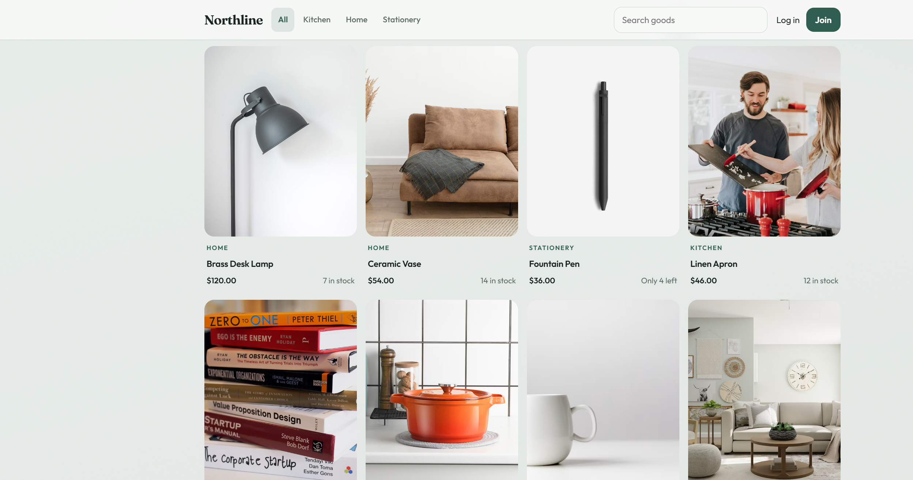
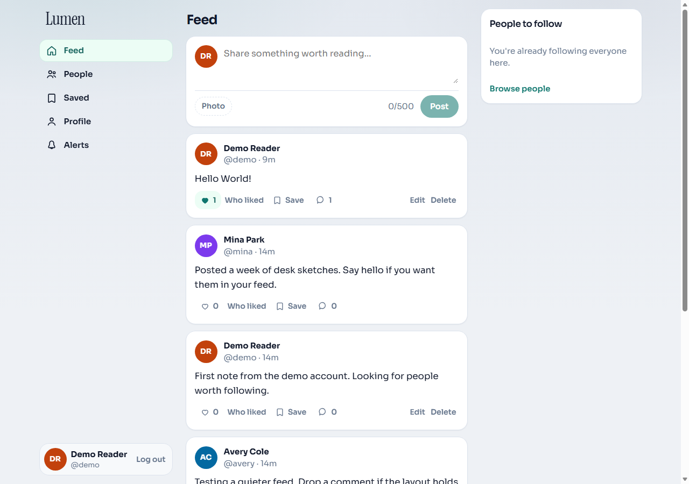
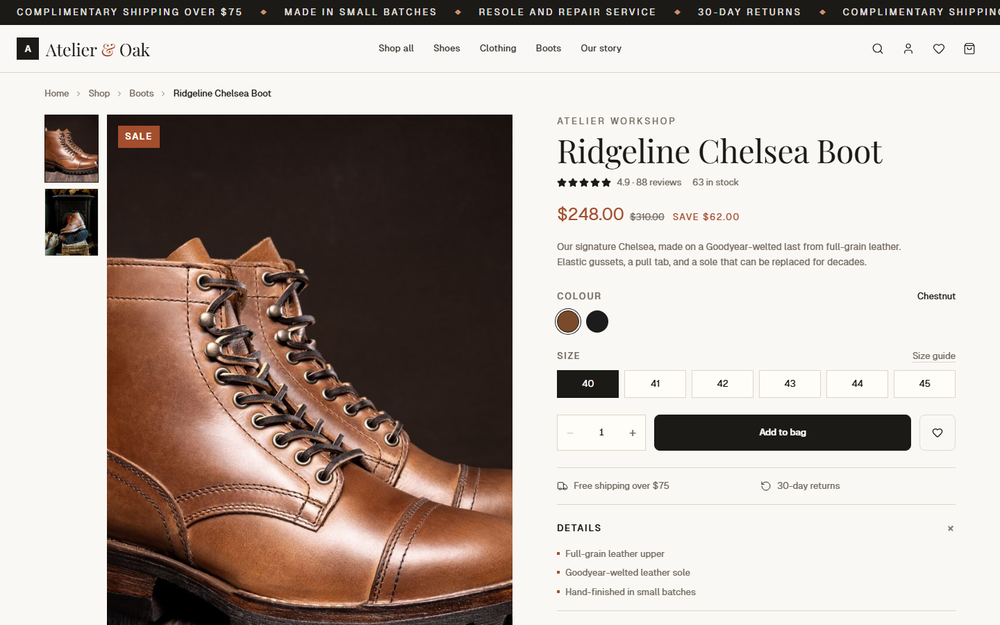

# CodeAlpha full-stack tasks

Three MERN applications built for the CodeAlpha full-stack internship, kept in one repository with shared tooling, tests, and a Docker Compose stack.

| App | What it does | Local address | API |
| --- | --- | --- | --- |
| [Northline shop](CodeAlpha_EcommerceStore) | Catalog, cart, checkout, reviews, wishlist, admin | http://localhost:5173 | http://localhost:5001 |
| [Lumen feed](CodeAlpha_SocialMedia) | Posts, comments, likes, follows, alerts | http://localhost:5174 | http://localhost:5002 |
| [Keel boards](CodeAlpha_ProjectManagement) | Projects, drag-and-drop tasks, comments, live updates | http://localhost:5175 | http://localhost:5003 |

Each app has its own README with the task checklist, API reference, and environment variables.

## Screenshots

| Northline shop | Lumen feed | Keel boards |
| --- | --- | --- |
|  |  |  |



## Architecture

```text
Browser (React + Vite)
  ├─ /api/*  ──> Express API ──> MongoDB
  └─ socket.io ──> Socket.io server (social alerts, live boards)
```

- **Clients** are React 18 apps built with Vite. The shop uses React Query and a cart context, the social app uses React Query plus Socket.io, and the project board uses dnd-kit with Socket.io rooms.
- **Servers** are Express APIs with Mongoose models, JWT authentication, bcrypt password hashing, Helmet, rate limiting, and input sanitising.
- **Database** is MongoDB. Checkout uses a transaction, so the shop needs a replica set (a single-node set is enough).
- **CI** runs ESLint for all servers and clients, the API test suites against a MongoDB replica set, and production builds for all three clients.

## Quick start with Docker

Requirements: Docker Desktop with Compose.

```bash
docker compose up --build -d
docker compose exec ecommerce-api npm run seed
docker compose exec social-api npm run seed
docker compose exec projects-api npm run seed
```

Then open http://localhost:5173, http://localhost:5174, and http://localhost:5175.

The stack starts a single-node MongoDB replica set (`rs0`), one API per app, and nginx containers that serve each client build and proxy `/api` to its API. Stop it with `docker compose down` (add `-v` to drop the database volume).

## Manual setup

Requirements: Node.js 18+ and MongoDB. The shop needs MongoDB running as a replica set:

```bash
# Either use the Compose database on its own
docker compose up -d mongo

# Or start mongod yourself, then run rs.initiate() once in mongosh
mongod --replSet rs0 --dbpath ./data/db
```

Install the root lint tooling and every app's dependencies:

```bash
npm run install:all
```

Create an environment file for each API if you are not using the local defaults:

```bash
copy CodeAlpha_EcommerceStore\.env.example CodeAlpha_EcommerceStore\server\.env
copy CodeAlpha_SocialMedia\.env.example CodeAlpha_SocialMedia\server\.env
copy CodeAlpha_ProjectManagement\.env.example CodeAlpha_ProjectManagement\server\.env
```

Seed the demo data, then start any app from its folder:

```bash
cd CodeAlpha_EcommerceStore
npm run seed
npm run dev
```

`npm run dev` starts the API and the Vite client together. See each app's README for its port, database name, and full API list.

## Demo accounts

Every seeded account uses the password `password123`.

| App | Accounts |
| --- | --- |
| Northline shop | `demo@codealpha.dev` (shopper), `admin@codealpha.dev` (add, hide, and ship) |
| Lumen feed | `demo@codealpha.dev`, `avery@codealpha.dev`, `mina@codealpha.dev` |
| Keel boards | `demo@codealpha.dev` (board owner), `avery@codealpha.dev` (member) |

## Tests and linting

From the repository root:

```bash
npm run lint         # ESLint for three servers and three clients
npm run test         # Jest API suites for all three servers
npm run build        # Production builds for all three clients
```

The API tests need MongoDB at `MONGO_URI`. To run them against a local replica set:

```bash
# PowerShell
$env:MONGO_URI='mongodb://127.0.0.1:27017/codealpha_ecommerce_test?replicaSet=rs0'
$env:NODE_ENV='test'
$env:JWT_SECRET='local-test-secret-at-least-32-characters'
npm --prefix CodeAlpha_EcommerceStore/server test
```

Use the same pattern with `codealpha_social_test` and `codealpha_projects_test` for the other two suites. CI (`.github/workflows/ci.yml`) does this automatically with a single-node MongoDB replica set running in Docker.

## Repository layout

```text
CodeAlpha_EcommerceStore/    Northline shop (client, server, docs)
CodeAlpha_SocialMedia/       Lumen feed (client, server, docs)
CodeAlpha_ProjectManagement/ Keel boards (client, server, docs)
.github/workflows/ci.yml     Lint, test, and build pipeline
docker-compose.yml           MongoDB replica set, APIs, and web clients
eslint.config.js             Shared client lint rules
```
